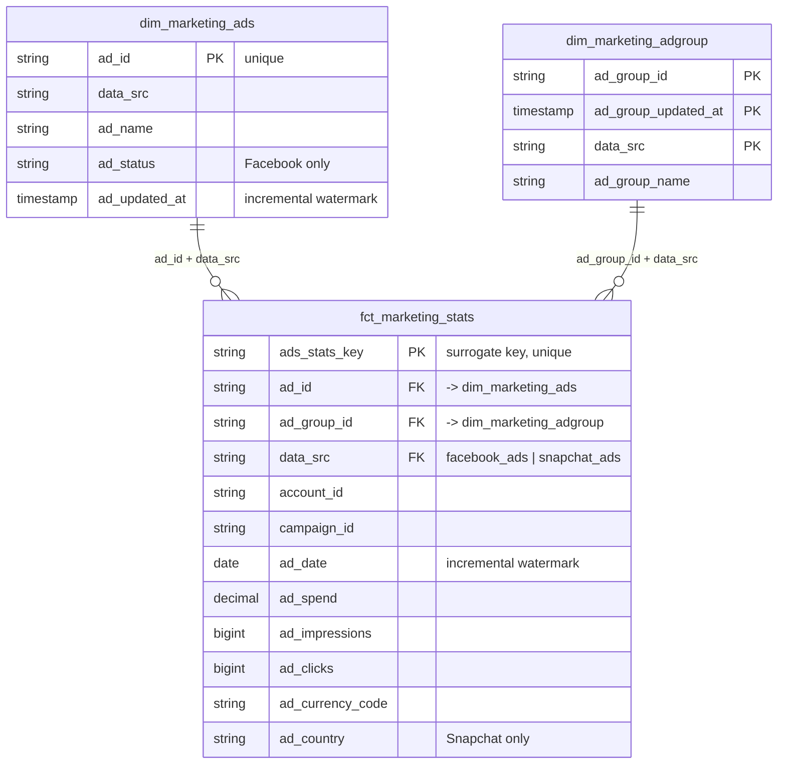

# Repository & CI/CD Guide

This repository contains the dbt project for marketing data (Facebook Ads + Snapchat Ads on Databricks) and the GitHub Actions pipelines that lint, test, deploy and monitor it.

> **Scope of this README:** the repository root, the CI/CD pipelines under `.github/`, and how to set up your environment (locally and on GitHub).
> For the dbt models, project configuration, tests and conventions, see **[cdc_marketing/README.md](cdc_marketing/README.md)**.

---

## Table of contents

1. [Repository layout](#1-repository-layout)
2. [Data model: fact ↔ dimension relationships](#2-data-model-fact--dimension-relationships)
3. [Pipeline overview](#3-pipeline-overview)
4. [Setting up GitHub](#8-setting-up-github)
5. [Setting up your local environment](#9-setting-up-your-local-environment)

---

## 1. Repository layout

```
.
├── .github/
│   ├── workflows/
│   │   ├── ci.yml                  # PR checks: SQL lint + dbt CI build
│   │   ├── close.yml               # PR closed: drop the PR's CI schema
│   │   ├── deploy_development.yml  # push to `development` -> deploy to dev
│   │   ├── deploy_production.yml   # push to `production`, daily cron, manual -> deploy to prod
│   │   └── _dbt.yml                # reusable workflow that runs dbt (called by the three above)
│   └── actions/
│       ├── setup_uv/               # Python + uv + dependency install (cached)
│       ├── dbt_ci_cd/              # the core dbt pipeline (composite action)
│       ├── export_dev_schema/      # derives the per-PR schema name -> $DEV_SCHEMA
│       └── elementary/             # generates + uploads the Elementary report
└── cdc_marketing/                  # the dbt project (see cdc_marketing/README.md)
    ├── models/
    │   ├── staging/                  # views: 1:1 cleaned source models (stg_facebook_*, stg_snapchat_*)
    │   ├── intermediate/             # tables: cross-platform harmonisation (int_marketing_*)
    │   │   ├── int_marketing_ads.sql / .yml
    │   │   ├── int_marketing_adgroup.sql / .yml
    │   │   └── int_marketing_ads_stats.sql / .yml
    │   └── marts/                    # incremental: analytics-ready models
    │       ├── dim_marketing_ads.sql / .yml
    │       ├── dim_marketing_adgroup.sql / .yml
    │       └── fct_marketing_stats.sql / .yml
    ├── macros/                       # custom macros (excluded from linting)
    ├── tests/                        # singular tests (excluded from linting)
    ├── analyses/
    ├── seeds/
    ├── snapshots/
    ├── dbt_project.yml               # project config, per-layer materialization, catalog/schema routing
    ├── profiles.yml                  # connection profiles for ci / dev / production (env-var driven)
    ├── packages.yml                  # package requirements
    ├── package-lock.yml              # pinned package versions
    ├── pyproject.toml                # Python deps (dbt-databricks, elementary-data, sqlfluff, diff-cover)
    ├── _sqlfluff                     # SQLFluff config
    └── _sqlfluffignore               # SQLFluff ignore patterns
└── logs
└── .gitignore
└── pyproject.toml
└── README.md
└── test.yml
└── uv.lock
```

---

## 2. Data model: fact ↔ dimension relationships

The marts consist of **one fact table** and **two dimension tables**. Details of each model live in [cdc_marketing/README.md](cdc_marketing/README.md); this section shows how they connect.




---

## 3. Pipeline overview
``

**Key ideas**

- **Three environments:** `ci` (per-PR, disposable), `dev`, `production`. They share the same code path (`_dbt.yml` → `dbt_ci_cd`), and behaviour differs only by `DBT_TARGET`.
- **State-based CI:** PRs only build what changed (plus one level downstream), by comparing against the latest production `manifest.json`.
- **Lint gate:** the dbt build only starts if the lint job passes.
- **Self-cleaning:** each PR builds into its own schema, which is dropped at the start of every run and again when the PR closes.

---

---

## 4. Setting up GitHub

### 4.1 Branches

| Branch | Role |
|---|---|
| `production` | Deploys to production on push. It is also the baseline for lint diffs (`origin/production`) and the source of the production manifest, so it should be the repository's **default branch** (scheduled workflows only run on the default branch). |
| `development` | Deploys to dev on push. |
| feature branches | Open PRs; `ci.yml` runs on every PR. |

Recommended branch protection (Settings → Branches) on `production` (and ideally `development`):

- Require a pull request before merging.
- Require status checks to pass: **`lint`** and **`build`** (the jobs from *Continuous Integration*).
- Restrict who can push directly.

### 4.2 Secrets

*Settings → Secrets and variables → Actions → **Secrets***

| Secret | Description |
|---|---|
| `DBX_ID_APPLICATION_ID` | Databricks service principal **OAuth client ID** |
| `DBX_SECRET` | Databricks service principal **OAuth client secret** |

### 4.3 Variables

*Settings → Secrets and variables → Actions → **Variables***

| Variable | Used by | Description |
|---|---|---|
| `DATABRICKS_HOST` | all | Workspace host URL |
| `HTTP_PATH` | all | SQL warehouse HTTP path |
| `CI_CATALOG` | ci, close | Catalog where PR schemas are created |
| `CI_SCHEMA` | (exported, see note) | Exported by `_dbt.yml`, but `profiles.yml` builds the CI schema from `DEV_SCHEMA` instead |
| `DEV_CATALOG` | dev | Catalog for the development deployment |
| `DEVELOPMENT_SCHEMA` | dev | Schema for the development deployment |
| `PROD_CATALOG` | production | Catalog for production |
| `PROD_SCHEMA` | production | Schema for production |
| `ELM_DEV_CATALOG` | dev | Elementary artefacts catalog (dev) |
| `ELM_DEV_SCHEMA` | dev | Elementary artefacts schema (dev) |
| `ELM_PROD_CATALOG` | production | Elementary artefacts catalog (production) |
| `ELM_PROD_SCHEMA` | production | Elementary artefacts schema (production) |

`DEV_SCHEMA` is **not** configured by hand: it is generated per PR by the `export_dev_schema` action.

### 4.4 Databricks prerequisites

- A **service principal** with an OAuth secret (M2M), used for all three targets.
- Access to the SQL warehouse referenced by `HTTP_PATH`.
- Permissions on each catalog (`CI_CATALOG`, `DEV_CATALOG`, `PROD_CATALOG`, and the Elementary catalogs) to read sources, create tables/views, and, for the CI catalog, **create and drop schemas** (the PR cleanup depends on it).
- The custom `drop_schemas` macro must exist in `cdc_marketing/macros/` (used by `ci` and `close.yml`).
- The seed `dbt_project_evaluator_exceptions` must exist (used by the evaluator step).


## 5. Setting up your local environment

All dbt commands run **inside `cdc_marketing/`**, where `dbt_project.yml` and `profiles.yml` live.

### 5.1 Install

```bash
cd cdc_marketing
uv sync                               # installs dbt-databricks, elementary-data, sqlfluff, diff-cover
```

### 5.2 Environment variables

`profiles.yml` is driven entirely by environment variables. Create a **git-ignored** `.env` file (inside `cdc_marketing/`):

```bash
# --- target selection ---
export DBT_TARGET=ci                       # ci (default) | dev | production

# --- Databricks connection (OAuth M2M) ---
export DATABRICKS_HOST="<workspace-host>"
export HTTP_PATH="<sql-warehouse-http-path>"
export DBX_ID_APPLICATION_ID="<client-id>"
export DBX_SECRET="<client-secret>"

# --- ci target (recommended for local work) ---
export CI_CATALOG="<ci-catalog>"
export DEV_SCHEMA="PR_LOCAL_<YOURNAME>"    # your personal sandbox schema prefix

```

Load it, then verify:

```bash
set -a; source .env; set +a
uv run dbt debug
uv run dbt deps
```

> **Which target locally?** Use `ci` with your own `DEV_SCHEMA` (e.g. `PR_LOCAL_JANE`). It mirrors what a PR does and keeps your work isolated. Avoid `dev` and **never** run `production` from your laptop. Elementary models are disabled on `ci`, so you don't need the `ELM_*` variables for it.

### 5.4 Everyday commands

```bash
# build only what you changed vs. the repo, similar to CI (needs a prod manifest in target_prod/, see below)
uv run dbt build --select state:modified+1 --defer --state target_prod

# or simply build a model and its parents
uv run dbt build --select +fct_marketing_stats

# validate SQL without moving data
uv run dbt run --select +fct_marketing_stats --empty
```

### 5.5 Run the same lint check as CI

From the **repo root**:

```bash
uv run --project cdc_marketing diff-quality \
  --violations sqlfluff \
  --compare-branch=origin/production \
  --fail-under=100
```

Or lint/fix everything directly (inside `cdc_marketing/`):

```bash
uv run sqlfluff lint models/
uv run sqlfluff fix models/
```

### 5.6 Clean up your sandbox schemas

Preview first, then delete:

```bash
uv run dbt run-operation drop_schemas --args "{dry_run: True,  schema_startswith: PR_LOCAL_<YOURNAME>}"
uv run dbt run-operation drop_schemas --args "{dry_run: False, schema_startswith: PR_LOCAL_<YOURNAME>}"
```

---
