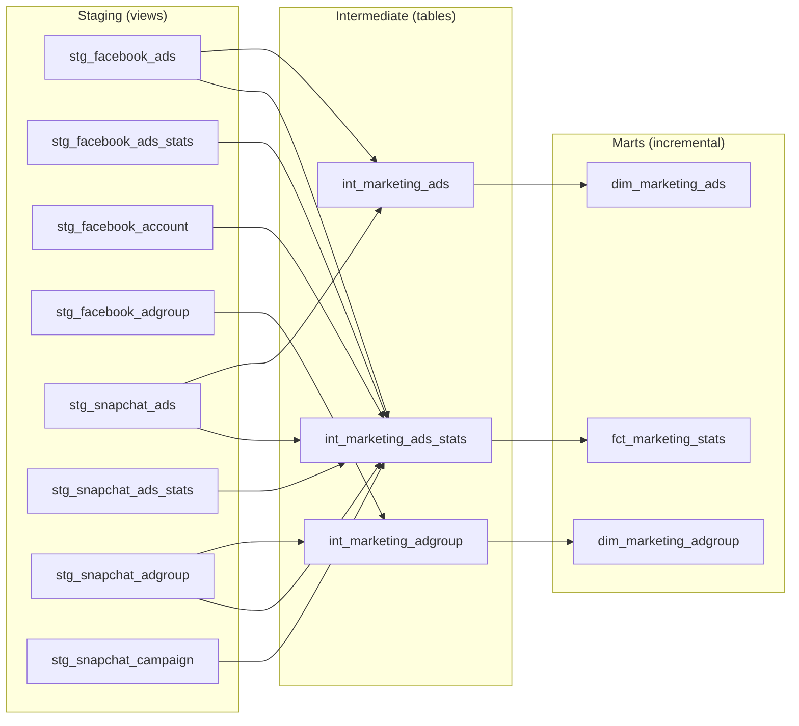

# cdc_marketing

A dbt project that consolidates paid-marketing data from **Facebook Ads** and **Snapchat Ads** into a single, platform-agnostic set of dimension and fact tables on **Databricks**.

- **Warehouse / adapter:** Databricks (`dbt-databricks`)
- **Orchestration & CI/CD:** GitHub Actions (3 environments: `ci`, `dev`, `production`)
- **Data quality:** dbt tests, `dbt_utils`, `dbt_expectations`, `elementary` observability
- **Project governance:** `dbt_project_evaluator`
- **SQL linting:** SQLFluff (Databricks dialect)

---

## Table of contents

1. [Project overview](#1-project-overview)
2. [Repository structure](#2-repository-structure)
3. [Data architecture & lineage](#3-data-architecture--lineage)
4. [Model reference](#4-model-reference)
5. [Materialization & incremental strategy](#5-materialization--incremental-strategy)
6. [Testing & data quality](#9-testing--data-quality)
7. [SQL style & linting](#10-sql-style--linting)
8. [Conventions](#13-conventions)
---

## 1. Project overview

The goal of this project is to build a production-minded Marketing Data Platform that consolidates Facebook Ads and Snapchat Ads data into a unified, documented, and quality-tested data model so the final model answers the required business questions.

Using **dbt, Databricks, and automated CI/CD workflows**, the platform aims to:

- Standardize advertising data across platforms.
- Provide a consistent view of marketing performance.
- Enable reliable, reusable analytics and reporting.
- Improve data quality through automated testing and monitoring.
- Improve transparency through model documentation and data lineage.
- Establish separate development and production environments for controlled deployments.

The result is a more accessible, maintainable, and trustworthy foundation for marketing analytics.


### Key business concepts

| Concept | Description |
|---|---|
| `data_src` | Origin platform of the row: `facebook_ads` or `snapchat_ads`. |
| Ad | A single ad unit within an ad group. |
| Ad group | Group of ads, belonging to a campaign. |
| Ads stats | One ad's performance for a single date (spend, impressions, clicks, currency, country where available). |

---

## 2. Repository structure

```
├── .github/                      # GitHub Actions workflows (CI/CD) - see section 12
|
cdc_marketing/
    ├── models/
    │   ├── staging/                  # views: 1:1 cleaned source models (stg_facebook_*, stg_snapchat_*)
    │   ├── intermediate/             # tables: cross-platform harmonisation (int_marketing_*)
    │   │   ├── int_marketing_ads.sql / .yml
    │   │   ├── int_marketing_adgroup.sql / .yml
    │   │   └── int_marketing_ads_stats.sql / .yml
    │   └── marts/                    # incremental: analytics-ready models
    │       ├── dim_marketing_ads.sql / .yml
    │       ├── dim_marketing_adgroup.sql / .yml
    │       └── fct_marketing_stats.sql / .yml
    ├── macros/                       # custom macros (excluded from linting)
    ├── tests/                        # singular tests (excluded from linting)
    ├── analyses/
    ├── seeds/
    ├── snapshots/
    ├── dbt_project.yml               # project config, per-layer materialization, catalog/schema routing
    ├── profiles.yml                  # connection profiles for ci / dev / production (env-var driven)
    ├── packages.yml                  # package requirements
    ├── package-lock.yml              # pinned package versions
    ├── pyproject.toml                # Python deps (dbt-databricks, elementary-data, sqlfluff, diff-cover)
    ├── _sqlfluff                     # SQLFluff config
    └── _sqlfluffignore               # SQLFluff ignore patterns
```

> The staging models (`stg_*`) and their sources are referenced by the intermediate layer; document their sources in `models/staging/` alongside the `.yml` files.

---

## 3. Data architecture & lineage



---

## 4. Model reference

### 4.1 Intermediate layer (`materialized: table`)

#### `int_marketing_ads`
One row per ad from Facebook or Snapchat.

| Column | Description |
|---|---|
| `ad_id` | Unique ad identifier (**tests:** `not_null`, `unique`) |
| `ad_name` | Ad name |
| `ad_status` | Current status. Available for Facebook only; `NULL` for Snapchat |
| `ad_updated_at` | Last-updated timestamp |
| `data_src` | `facebook_ads` or `snapchat_ads` |

Logic: `SELECT DISTINCT` per platform from `stg_facebook_ads` / `stg_snapchat_ads`, then `UNION ALL`.

#### `int_marketing_adgroup`
One row per ad group per platform (latest version only).

| Column | Description |
|---|---|
| `ad_group_id` | Ad group identifier (`not_null`) |
| `ad_group_name` | Ad group name |
| `ad_group_updated_at` | Last-updated timestamp (`not_null`) |
| `data_src` | Source platform (`not_null`) |

Logic: each platform is de-duplicated with `QUALIFY ROW_NUMBER() OVER (PARTITION BY ad_group_id ORDER BY ad_group_updated_at DESC) = 1`, then `UNION ALL`.
Model-level test: `dbt_utils.unique_combination_of_columns` on (`ad_group_id`, `ad_group_updated_at`, `data_src`).

#### `int_marketing_ads_stats`
One row per ad per date per platform. Configured with `event_time='ad_date'`.

| Column | Description |
|---|---|
| `ads_stats_key` | Surrogate key (`not_null`, `unique`) |
| `ad_id` | Ad identifier (`not_null`) |
| `account_id` | Advertising account. For Snapchat, derived via ad group → campaign |
| `ad_spend` | Amount spent |
| `ad_impressions` | Number of impressions |
| `ad_clicks` | Number of clicks |
| `ad_date` | Date of the performance record |
| `ad_country` | Country (Snapchat only; `NULL` for Facebook) |
| `ad_currency_code` | Currency (Facebook: from `stg_facebook_account`; Snapchat: from stats) |
| `data_src` | `facebook_ads` or `snapchat_ads` (`not_null`) |
| `campaign_id` | Campaign identifier |
| `ad_group_id` | Ad group identifier |

Join logic:

- **Facebook:** `stg_facebook_ads_stats` ⟕ `stg_facebook_account` (currency) ⟕ `stg_facebook_ads` (campaign, ad group)
- **Snapchat:** `stg_snapchat_ads_stats` ⟕ `stg_snapchat_ads` ⟕ `stg_snapchat_adgroup` ⟕ `stg_snapchat_campaign`

### 4.2 Marts (`materialized: incremental`)

| Model | Grain | `unique_key` | Incremental filter |
|---|---|---|---|
| `dim_marketing_ads` | 1 row per `ad_id` | `ad_id` | `ad_updated_at >= MAX(ad_updated_at)` of target |
| `dim_marketing_adgroup` | 1 row per `ad_group_id` + `ad_group_updated_at` + `data_src` | composite of the three | `ad_group_updated_at >= MAX(ad_group_updated_at)` of target |
| `fct_marketing_stats` | 1 row per ad per date per platform | `ads_stats_key` | `ad_date >= MAX(ad_date)` of target |

All marts are `SELECT *` from their corresponding intermediate model, so column definitions match section 4.1.

---

## 5. Materialization & incremental strategy

Configured in `dbt_project.yml`:

| Layer | Materialization | Purpose |
|---|---|---|
| `staging` | `view` | Lightweight, always-fresh pass-through of sources |
| `intermediate` | `table` | Rebuilt fully each run; holds cross-platform logic |
| `marts` | `incremental` | Merge-upserts only new/changed rows into the final tables |

**Incremental pattern**

```sql

    WHERE <watermark_column> >= (SELECT MAX(<watermark_column>) FROM {{ this }})

```

- The `>=` (not `>`) re-processes the latest watermark value so late-arriving rows with the same timestamp/date are captured.
- Records are **merged** on `unique_key`, so re-processed rows overwrite rather than duplicate.

---

## 6. Testing & data quality

### Schema tests (defined in the model `.yml` files)

| Model | Tests |
|---|---|
| `int_marketing_ads` | `ad_id`: `not_null`, `unique` |
| `int_marketing_adgroup` | `ad_group_id`, `ad_group_updated_at`, `data_src`: `not_null`; unique combination of (`ad_group_id`, `ad_group_updated_at`, `data_src`) |
| `int_marketing_ads_stats` | `ads_stats_key`: `not_null`, `unique`; `data_src`, `ad_id`: `not_null` |
| `dim_marketing_ads` | `ad_id`: `not_null`, `unique` |
| `dim_marketing_adgroup` | same as `int_marketing_adgroup` |
| `fct_marketing_stats` | `ads_stats_key`: `not_null`, `unique`; `data_src`, `ad_id`: `not_null` |


Singular tests was also done in tests/singular/.

### Observability
Elementary is enabled in `dev` and `production` and stores its artefacts in a dedicated schema (`elementary`) in the catalogs defined by `ELM_*_CATALOG`.

### Governance
`dbt_project_evaluator` audits DAG structure, naming, testing and documentation coverage. It only runs outside `dev`/`production` and only when explicitly enabled:

```bash
ENABLE_DBT_PROJECT_EVALUATOR=true dbt build --select package:dbt_project_evaluator
```

### Running tests

```bash
dbt test                              # all tests
dbt test -s int_marketing_ads_stats   # one model
dbt build -s +fct_marketing_stats     # run + test a model and its upstream
```

---

## 7. SQL style & linting

SQLFluff is configured in `_sqlfluff`:

| Setting | Value |
|---|---|
| Dialect | `databricks` |
| Templater | `jinja` (with `apply_dbt_builtins = True`, macros loaded from `macros/`) |
| Max line length | 120 |
| Excluded rules | `AM04`, `RF02`, `RF03`, `ST06` |
| Ignored errors | `templating`: avoids failures on dbt runtime-only objects such as `flags` |

`_sqlfluffignore` skips: `target/`, `dbt_modules/`, `dbt_packages/`, `macros/`, `tests/`, `analyses/`, `.venv/`.

```bash
sqlfluff lint models/
sqlfluff fix models/
```

`diff-cover` is included in the dev dependencies so that checks can be scoped to changed lines in pull requests.

---

## 8. Conventions

| Item | Convention |
|---|---|
| Model prefixes | `stg_` staging, `int_` intermediate, `dim_` / `fct_` marts |
| Keywords | Upper-case SQL keywords (`SELECT`, `FROM`, `LEFT JOIN`) |
| CTEs | One CTE per source/platform, followed by a `combined` CTE; final `SELECT * FROM combined` |
| Platform tag | Every integrated row carries `data_src` (`facebook_ads` / `snapchat_ads`) |
| Column prefixes | `ad_` for ad metrics/attributes, `ad_group_` for ad group attributes |
| Docs & tests | Each model has a same-named `.yml` with description, column docs and tests |
| Test key | Use `data_tests:` (dbt ≥ 1.8 syntax) |

---
